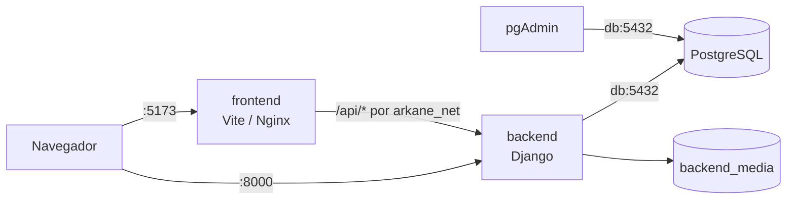

# Arkane Zone

Sistema de gestión para una tienda de videojuegos. El repositorio está organizado como un **monorepo** con dos aplicaciones independientes y un stack de infraestructura reproducible con Docker Compose.

| Carpeta / archivo | Contenido |
|---|---|
| [`backend/`](backend/README.md) | Aplicación Django 5.2 (modelo de datos, reglas de negocio, autenticación, admin y API/HTML) |
| [`frontend/`](frontend/README.md) | Aplicación Vite + React + TypeScript + Tailwind CSS |
| [`compose.yaml`](compose.yaml) | Stack de desarrollo: PostgreSQL, backend, frontend y pgAdmin |
| [`compose.prod.yaml`](compose.prod.yaml) | Override de producción (Gunicorn + Nginx) |
| [`.env.example`](.env.example) | Plantilla única de variables de entorno para todo el stack |
| [`render.yaml`](render.yaml) | Blueprint de despliegue del backend en Render |

> **Nota sobre el frontend:** el issue AZ-S1-22 menciona Next.js, pero el repositorio ya contiene un frontend inicializado con **Vite + React + TypeScript** (issue AZ-S2-01). El stack Docker se construyó sobre el frontend real y es agnóstico al framework: si más adelante se migra a Next.js, solo cambia el `Dockerfile` de `frontend/`.

## Inicio rápido con Docker

### Requisitos

- Docker Engine 24 o superior.
- Docker Compose v2 (`docker compose`, no `docker-compose`).
- Puertos libres en el host: `8000` (backend), `5173` (frontend), `5432` (PostgreSQL) y `5050` (pgAdmin). Todos se pueden cambiar en `.env`.

### 1. Configurar variables de entorno

```bash
cp .env.example .env
```

Edita `.env` y reemplaza todos los valores `replace-with-...`. Como mínimo:

```dotenv
DJANGO_SECRET_KEY=<genera una clave con: openssl rand -hex 32>
POSTGRES_PASSWORD=<contraseña fuerte>
PGADMIN_DEFAULT_PASSWORD=<contraseña fuerte>
```

El archivo `.env` está excluido de Git. Nunca versiones credenciales reales.

### 2. Construir y levantar

```bash
docker compose up -d --build
```

El backend espera a que PostgreSQL esté saludable, aplica migraciones, recolecta estáticos y arranca. El frontend espera a que el backend esté saludable.

### 3. Verificar

```bash
docker compose ps
curl -I http://localhost:8000/
curl -I http://localhost:5173/
curl -I http://localhost:5173/api/catalogo/
```

Todos los servicios deben aparecer como `healthy`. Si alguno queda en `starting`, revisa los logs:

```bash
docker compose logs -f backend
docker compose logs -f frontend
docker compose logs -f db
docker compose logs -f pgadmin
```

### 4. Accesos

| Servicio | URL | Notas |
|---|---|---|
| Frontend | <http://localhost:5173> | Vite dev server; en producción, Nginx |
| Backend / admin | <http://localhost:8000/> | Django; admin en `/admin/` |
| API a través del frontend | <http://localhost:5173/api/catalogo/> | Vite/Nginx reenvía `/api/*` a `backend:8000` |
| pgAdmin | <http://localhost:5050> | Usuario y contraseña de `.env` |
| PostgreSQL | `localhost:5432` | Solo para clientes externos; los contenedores usan `db:5432` |

Para crear un superusuario:

```bash
docker compose exec backend python manage.py createsuperuser
```

Para cargar datos de ejemplo del catálogo:

```bash
docker compose exec backend python manage.py seed_catalogo
```

### Registrar PostgreSQL en pgAdmin

1. Abre <http://localhost:5050> e inicia sesión con `PGADMIN_DEFAULT_EMAIL` y `PGADMIN_DEFAULT_PASSWORD`.
2. Clic derecho en **Servers → Register → Server**.
3. En **General**, asigna un nombre (por ejemplo `Arkane Zone`).
4. En **Connection**, usa:
   - Host: `db` (nombre del servicio Docker, no `localhost`).
   - Port: `POSTGRES_PORT` (por defecto `5432`).
   - Maintenance database: `POSTGRES_DB`.
   - Username: `POSTGRES_USER`.
   - Password: `POSTGRES_PASSWORD`.
5. Guarda y abre la base `POSTGRES_DB`.

También puedes conectarte por consola:

```bash
docker compose exec db psql -U arkane -d arkane_zone
```

## Servicios y red

```text
┌─────────────────────────────────────────────────────────────┐
│ Host                                                        │
│  :5173 → frontend      :8000 → backend                      │
│  :5432 → db            :5050 → pgadmin                      │
└─────────────────────────────────────────────────────────────┘
                    red interna: arkane_net
        ┌──────────────┬──────────────┬──────────────┐
        │   frontend   │   backend    │     db       │
        │  (Vite/Nginx)│  (Django)    │ (PostgreSQL) │
        └──────┬───────┴──────┬───────┴──────┬───────┘
               │ /api/*       │              │
               └─────────────►│──────────────┘
                              │
                        ┌─────┴──────┐
                        │  pgadmin   │
                        └────────────┘
```

- `frontend` usa el nombre de servicio `backend` para el proxy `/api/*`. No usa `localhost` del host.
- `backend` usa el nombre de servicio `db` para conectarse a PostgreSQL.
- `pgadmin` usa `db` como host al registrar el servidor.
- La red `arkane_net` es explícita y de tipo `bridge`.
- Los nombres de servicio (`db`, `backend`, `frontend`, `pgadmin`) son estables y resolubles por DNS interno.

## Variables de entorno

Toda la configuración está centralizada en el `.env` de la raíz. El Compose no contiene credenciales, hosts ni puertos sensibles quemados. Consulta [`.env.example`](.env.example) para la lista completa y comentada.

| Grupo | Variables principales |
|---|---|
| Proyecto | `COMPOSE_PROJECT_NAME`, `IMAGE_TAG`, `TZ` |
| Backend | `DJANGO_SECRET_KEY`, `DJANGO_DEBUG`, `DJANGO_ALLOWED_HOSTS`, `DJANGO_CSRF_TRUSTED_ORIGINS`, `SECURE_SSL_REDIRECT`, `BACKEND_HOST`, `BACKEND_PORT`, `BACKEND_PUBLISHED_PORT`, `BACKEND_WORKERS`, `BACKEND_TIMEOUT`, `RUN_MIGRATIONS`, `COLLECTSTATIC`, `SEED_CATALOGO` |
| PostgreSQL | `POSTGRES_DB`, `POSTGRES_USER`, `POSTGRES_PASSWORD`, `POSTGRES_HOST`, `POSTGRES_PORT`, `POSTGRES_PUBLISHED_PORT` |
| pgAdmin | `PGADMIN_DEFAULT_EMAIL`, `PGADMIN_DEFAULT_PASSWORD`, `PGADMIN_PORT`, `PGADMIN_PUBLISHED_PORT` |
| Frontend | `FRONTEND_PORT`, `FRONTEND_PUBLISHED_PORT`, `VITE_API_BASE_URL` |

Los valores de `.env.example` son ficticios y solo ilustran el formato. En producción usa secretos reales gestionados fuera del repositorio.

Las variables marcadas como obligatorias usan la sintaxis `${VAR:?mensaje}` de Compose: si falta alguna, `docker compose` falla antes de crear contenedores con un mensaje claro.

## Comandos útiles

```bash
# Levantar / actualizar
docker compose up -d --build

# Ver estado y salud
docker compose ps

# Logs en vivo
docker compose logs -f
docker compose logs -f backend

# Ejecutar comandos Django
docker compose exec backend python manage.py migrate
docker compose exec backend python manage.py createsuperuser
docker compose exec backend python manage.py seed_catalogo
docker compose exec backend python manage.py shell

# Detener sin borrar datos
docker compose stop

# Detener y eliminar contenedores/red (los volúmenes se conservan)
docker compose down

# Detener y eliminar TODO, incluidos los datos (destructivo)
docker compose down -v

# Reconstruir un solo servicio
docker compose build backend
docker compose up -d --build backend
```

## Persistencia y respaldos

Volúmenes nombrados:

| Volumen | Contenido |
|---|---|
| `postgres_data` | Datos de PostgreSQL (`PGDATA`) |
| `pgadmin_data` | Configuración y servidores registrados en pgAdmin |
| `backend_media` | Archivos subidos (portadas, medios) |
| `backend_static` | Estáticos recolectados por Django |

Los datos **no** viven en la capa efímera del contenedor. `docker compose down` conserva los volúmenes; solo `docker compose down -v` los elimina.

### Respaldo de PostgreSQL

```bash
docker compose exec -T db pg_dump \
  -U "$(grep '^POSTGRES_USER=' .env | cut -d= -f2)" \
  -d "$(grep '^POSTGRES_DB=' .env | cut -d= -f2)" \
  > backup_arkane_$(date +%Y%m%d_%H%M%S).sql
```

O de forma explícita, sin leer `.env`:

```bash
docker compose exec -T db pg_dump -U arkane -d arkane_zone > backup.sql
```

### Restauración

```bash
cat backup.sql | docker compose exec -T db psql -U arkane -d arkane_zone
```

Si vas a restaurar sobre una base existente, detén primero el backend para evitar conexiones activas:

```bash
docker compose stop backend frontend
cat backup.sql | docker compose exec -T db psql -U arkane -d arkane_zone
docker compose start backend frontend
```

## Desarrollo y producción

### Desarrollo (por defecto)

```bash
docker compose up -d --build
```

- Backend con `runserver` y `DEBUG=True` (según `.env`).
- Frontend con Vite dev server y proxy `/api/*` hacia `backend`.
- Código horneado en la imagen; para aplicar cambios vuelve a construir el servicio correspondiente.

### Producción

```bash
docker compose -f compose.yaml -f compose.prod.yaml up -d --build
```

El override de producción:

- Ejecuta el backend con **Gunicorn** (workers y timeout configurables).
- Sirve el frontend compilado con **Nginx sin privilegios**.
- Fuerza `DEBUG=False` y mantiene `SECURE_SSL_REDIRECT=False` dentro del contenedor para que el healthcheck HTTP funcione detrás de un proxy TLS.
- Usa `restart: always`.

Antes de usarlo:

1. Define `DJANGO_DEBUG=False` y secretos fuertes en `.env`.
2. Agrega tu dominio a `DJANGO_ALLOWED_HOSTS` y `DJANGO_CSRF_TRUSTED_ORIGINS`.
3. Termina TLS en un proxy inverso externo (Nginx, Caddy, balanceador cloud).
4. Para secretos de producción, usa **Docker secrets** (Swarm) o el gestor de secretos de tu plataforma; no los guardes en `.env` versionado ni en el repositorio.
5. **Medios:** con `DEBUG=False` Django no sirve `/media/`. Configura S3/Supabase Storage (variables `AWS_*`) o sirve el volumen `backend_media` desde tu proxy inverso.
6. **pgAdmin:** en producción se exige una *master password* adicional en el primer acceso.

Ejemplo de secretos con Docker Swarm (referencia, no requerido para desarrollo):

```bash
printf '%s' 'mi-password-real' | docker secret create postgres_password -
```

Luego referencia el secreto desde el servicio (`secrets:`) y léelo en el entrypoint. En un entorno sin Swarm, usa variables inyectadas por el orquestador o un gestor externo (Vault, AWS Secrets Manager, etc.).

## Arquitectura de la aplicación



El backend concentra el modelo de datos, la autenticación, la lógica de catálogo, carrito, pedidos, pagos, reportes y soporte. El frontend consume la API a través de `/api/*`; el proxy interno evita depender de `localhost` del host.

## Desarrollo local sin Docker

### Backend

```bash
cd backend
python -m venv .venv
source .venv/bin/activate        # Windows: .venv\Scripts\activate
pip install -r requirements.txt
cp .env.example .env             # completar SECRET_KEY y DATABASE_URL
python manage.py migrate
python manage.py seed_catalogo
python manage.py createsuperuser
python manage.py runserver
```

Disponible en <http://127.0.0.1:8000/>. Instrucciones detalladas en [`backend/README.md`](backend/README.md).

### Frontend

```bash
cd frontend
npm ci
npm run dev
```

Disponible en <http://localhost:5173/>. Instrucciones detalladas en [`frontend/README.md`](frontend/README.md).

## Validación del stack

Comprobado en un entorno limpio con Docker Compose:

- `docker compose config` y `docker compose -f compose.yaml -f compose.prod.yaml config` sin errores.
- Build de las imágenes de backend y frontend (dev y producción).
- Los cuatro servicios arrancan y alcanzan estado `healthy`.
- `GET /` del backend responde `200`.
- `GET /` del frontend responde `200`.
- `GET /api/catalogo/` a través del frontend responde `200` (proxy interno hacia `backend`).
- `GET /misc/ping` de pgAdmin responde `200` desde dentro del contenedor.
- Conectividad backend → PostgreSQL verificada con `manage.py shell`.
- Persistencia verificada: se creó un registro, se ejecutó `docker compose down` (sin `-v`), se volvió a levantar el stack y el registro seguía presente.
- Backend de producción arranca con Gunicorn y el frontend con Nginx.

## Documentación

- [Backend](backend/README.md)
- [Frontend](frontend/README.md)
- [Auditoría inicial](docs/audit/INITIAL-AUDIT.md)
- [Plan del Sprint 1](docs/sprints/SPRINT-1.md)
- [Diagrama de clases](docs/Diagrama%20de%20clases.drawio.png)
- [Diagrama entidad-relación](docs/Diagrama%20entidad%20relaci%C3%B3n%20drawio.png)

## Convenciones y seguridad

- No subir `.env`, credenciales, tokens ni claves. Usa [`.env.example`](.env.example) como plantilla.
- Cambia todos los valores de ejemplo antes de ejecutar en cualquier entorno compartido.
- Las imágenes usan versiones explícitas (`postgres:16.4-alpine`, `node:22.14.0-alpine`, `python:3.12.9-slim`, `dpage/pgadmin4:8.14`, `nginxinc/nginx-unprivileged:1.27-alpine`).
- Backend y frontend se ejecutan con usuarios no privilegiados.
- Los cambios de infraestructura, modelo de datos o configuración de producción deben revisarse con el equipo.

## Rama e issue

- Rama de trabajo: `feature/AZ-S1-22-docker-compose`.
- Issue: **AZ-S1-22 — Containerizar frontend, backend y base de datos con Docker Compose**.
