# Diagrama entidad-relación — esquema final

**Issue:** #20 · AZ-S1-18 · **Alcance:** capa de datos.

Diagrama lógico del esquema normalizado implementado en PostgreSQL/SQLite.
Las claves foráneas son `PROTECT` salvo las excepciones indicadas en el
diccionario (`DetallePedido.pedido` es `CASCADE`; `Contacto.usuario` es
`SET_NULL`; `UsuarioRol.usuario` es `CASCADE`).

El diagrama editable histórico del proyecto está en
[`resources/database/Diagrama entidad relación drawio.png`](<resources/database/Diagrama entidad relación drawio.png>).
Este archivo `.md` es la fuente versionada y actualizada del esquema final.

## Diagrama Mermaid

```mermaid
erDiagram
    ROL {
        bigint id PK
        varchar codigo UK "máx. 50, estable"
        varchar nombre UK "máx. 50, etiqueta"
        text descripcion
        boolean activo
    }

    USUARIO {
        bigint id PK
        varchar username UK "heredado de AbstractUser"
        varchar password
        varchar email "NO único: deuda técnica"
        varchar first_name
        varchar last_name
        boolean is_staff
        boolean is_active
        boolean is_superuser
        datetime last_login
        datetime date_joined
        varchar telefono "máx. 20"
        text direccion
        varchar foto "ruta de archivo"
    }

    USUARIO_ROL {
        bigint id PK
        bigint usuario_id FK "CASCADE"
        bigint rol_id FK "PROTECT"
    }

    CATEGORIA {
        bigint id PK
        varchar nombre UK "máx. 100"
        text descripcion
        boolean activo
    }

    GENERO {
        bigint id PK
        varchar nombre UK "máx. 100"
        text descripcion
        boolean activo
    }

    PLATAFORMA {
        bigint id PK
        varchar nombre UK "máx. 100"
        text descripcion
        boolean activo
    }

    VIDEOJUEGO {
        bigint id PK
        varchar titulo "máx. 200"
        text descripcion
        varchar portada "ruta de archivo"
        date fecha_lanzamiento
        boolean activo
        datetime creado_en
        datetime actualizado_en
    }

    VIDEOJUEGO_CATEGORIA {
        bigint id PK
        bigint videojuego_id FK
        bigint categoria_id FK
    }

    VIDEOJUEGO_GENERO {
        bigint id PK
        bigint videojuego_id FK
        bigint genero_id FK
    }

    ESTADO_PUBLICACION {
        bigint id PK
        varchar codigo UK "máx. 50, estable"
        varchar nombre "máx. 100, etiqueta"
        text descripcion
    }

    OFERTA_VIDEOJUEGO {
        bigint id PK
        bigint videojuego_id FK
        bigint plataforma_id FK
        decimal precio_vigente "numeric(10,2) >= 0"
        varchar sku UK "máx. 50"
        int stock ">= 0"
        varchar estado_publicacion FK "→ ESTADO_PUBLICACION.codigo"
        datetime creado_en
        datetime actualizado_en
    }

    ESTADO_PEDIDO {
        bigint id PK
        varchar codigo UK "máx. 50, estable"
        varchar nombre "máx. 100, etiqueta"
        text descripcion
    }

    PEDIDO {
        bigint id PK
        bigint cliente_id FK
        varchar estado FK "→ ESTADO_PEDIDO.codigo"
        datetime creado_en
        datetime actualizado_en
    }

    DETALLE_PEDIDO {
        bigint id PK
        bigint pedido_id FK
        bigint oferta_id FK
        int cantidad ">= 1"
        decimal precio_unitario "numeric(10,2) >= 0"
        varchar titulo_snapshot "máx. 200, congelado"
        varchar plataforma_snapshot "máx. 100, congelado"
    }

    ESTADO_INTENTO_PAGO {
        bigint id PK
        varchar codigo UK "máx. 50, estable"
        varchar nombre "máx. 100, etiqueta"
        text descripcion
    }

    PAGO {
        bigint id PK
        bigint pedido_id FK,UK "OneToOne"
        decimal monto "numeric(10,2) >= 0"
        varchar estado FK "→ ESTADO_INTENTO_PAGO.codigo"
        varchar referencia "máx. 100, sin unicidad"
        datetime creado_en
    }

    VENTA {
        bigint id PK
        bigint pedido_id FK,UK "OneToOne"
        decimal total "numeric(10,2) >= 0"
        datetime registrada_en
    }

    TIPO_MOVIMIENTO {
        bigint id PK
        varchar codigo UK "máx. 50"
        varchar nombre "máx. 100"
        text descripcion
        varchar naturaleza "entrada|salida|ajuste"
        boolean activo
    }

    MOTIVO_MOVIMIENTO {
        bigint id PK
        varchar codigo UK "máx. 50"
        varchar nombre "máx. 100"
        text descripcion
        boolean activo
    }

    MOVIMIENTO_INVENTARIO {
        bigint id PK
        bigint oferta_id FK
        bigint tipo_movimiento_id FK
        bigint motivo_id FK
        text observacion
        int cantidad "> 0"
        varchar unidad "máx. 50"
        int saldo_anterior ">= 0"
        int saldo_posterior ">= 0"
        datetime fecha_hora
        bigint usuario_responsable_id FK
        bigint detalle_pedido_id FK,UK "único si no es null"
        varchar clave_idempotencia UK "máx. 200"
        bigint movimiento_compensado_id FK
    }

    CONTACTO {
        bigint id PK
        varchar nombre "máx. 150"
        varchar email "máx. 254"
        varchar telefono "máx. 20"
        varchar asunto "máx. 200"
        text mensaje
        bigint usuario_id FK
        datetime creado_en
        boolean atendido
    }

    USUARIO ||--o{ USUARIO_ROL : "tiene"
    ROL ||--o{ USUARIO_ROL : "se asigna en"
    CATEGORIA ||--o{ VIDEOJUEGO_CATEGORIA : "clasifica"
    VIDEOJUEGO ||--o{ VIDEOJUEGO_CATEGORIA : "tiene"
    GENERO ||--o{ VIDEOJUEGO_GENERO : "clasifica"
    VIDEOJUEGO ||--o{ VIDEOJUEGO_GENERO : "tiene"
    VIDEOJUEGO ||--o{ OFERTA_VIDEOJUEGO : "se vende como"
    PLATAFORMA ||--o{ OFERTA_VIDEOJUEGO : "edición en"
    ESTADO_PUBLICACION ||--o{ OFERTA_VIDEOJUEGO : "estado"
    USUARIO ||--o{ PEDIDO : "realiza"
    ESTADO_PEDIDO ||--o{ PEDIDO : "estado"
    PEDIDO ||--o{ DETALLE_PEDIDO : "contiene"
    OFERTA_VIDEOJUEGO ||--o{ DETALLE_PEDIDO : "se adquiere en"
    PEDIDO ||--o| PAGO : "tiene intento"
    ESTADO_INTENTO_PAGO ||--o{ PAGO : "estado"
    PEDIDO ||--o| VENTA : "se consolida en"
    OFERTA_VIDEOJUEGO ||--o{ MOVIMIENTO_INVENTARIO : "registra movimientos"
    TIPO_MOVIMIENTO ||--o{ MOVIMIENTO_INVENTARIO : "clasifica"
    MOTIVO_MOVIMIENTO ||--o{ MOVIMIENTO_INVENTARIO : "justifica"
    USUARIO ||--o{ MOVIMIENTO_INVENTARIO : "es responsable"
    DETALLE_PEDIDO ||--o| MOVIMIENTO_INVENTARIO : "origina salida"
    MOVIMIENTO_INVENTARIO ||--o{ MOVIMIENTO_INVENTARIO : "compensa"
    USUARIO ||--o{ CONTACTO : "envía"
```

> Nota de Mermaid: las cardinalidades `||--o|` representan relaciones
> `OneToOne`; `||--o{` representa `ForeignKey` uno-a-muchos. Las tablas puente
> materializan relaciones muchos-a-muchos: `USUARIO_ROL` entre usuarios y roles de
> negocio, y `VIDEOJUEGO_CATEGORIA` / `VIDEOJUEGO_GENERO` entre títulos y
> catálogos. Los catálogos de estado (`ESTADO_PEDIDO`, `ESTADO_INTENTO_PAGO`,
> `ESTADO_PUBLICACION`) se referencian por `codigo` estable
> (`to_field="codigo"`). Las claves compuestas y los nombres exactos de los
> `CheckConstraint` se documentan en `docs/diccionario_datos.md`.

## Reglas de integridad representadas

| Entidad | Regla SQL |
|---|---|
| `ROL` | `codigo` único (identificador estable) y `nombre` único (etiqueta). |
| `USUARIO_ROL` | `(usuario, rol)` único; FK a usuario `CASCADE`; FK a rol `PROTECT`. |
| `VIDEOJUEGO_CATEGORIA` | `(videojuego, categoria)` único; FK a videojuego `CASCADE`; FK a categoría `PROTECT`. |
| `VIDEOJUEGO_GENERO` | `(videojuego, genero)` único; FK a videojuego `CASCADE`; FK a género `PROTECT`. |
| `ESTADO_PUBLICACION` | `codigo` único (catálogo de estados editoriales). |
| `OFERTA_VIDEOJUEGO` | `(videojuego, plataforma)` único; `sku` único; `precio_vigente >= 0`; `stock >= 0`; `estado_publicacion` FK `PROTECT` a `ESTADO_PUBLICACION.codigo`. |
| `ESTADO_PEDIDO` | `codigo` único (catálogo de estados de pedido). |
| `PEDIDO` | `estado` FK `PROTECT` a `ESTADO_PEDIDO.codigo`. |
| `DETALLE_PEDIDO` | `(pedido, oferta)` único; `cantidad >= 1`; `precio_unitario >= 0`. |
| `ESTADO_INTENTO_PAGO` | `codigo` único (catálogo de estados de intento de pago). |
| `PAGO` | `pedido` único (OneToOne); `monto >= 0`; `estado` FK `PROTECT` a `ESTADO_INTENTO_PAGO.codigo`. |
| `VENTA` | `pedido` único (OneToOne); `total >= 0`. |
| `MOVIMIENTO_INVENTARIO` | `clave_idempotencia` única; `detalle_pedido` único si no es null; `cantidad > 0`; saldos `>= 0`; inmutable vía ORM. |

`TipoMovimientoInventario.naturaleza` (`entrada`/`salida`/`ajuste`) permanece
como `TextChoices` sin `CheckConstraint` por decisión de alcance (AZ-S1-17,
coherente con AZ-S1-14). Las transiciones entre estados de pedido, pago y
publicación se documentan en `docs/adr_az-s1-17-estados-catalogo.md` y no se
aplican en base de datos. La frontera entre roles de negocio y permisos técnicos
de Django se documenta en `docs/adr_az-s1-18-roles-usuario.md`.
